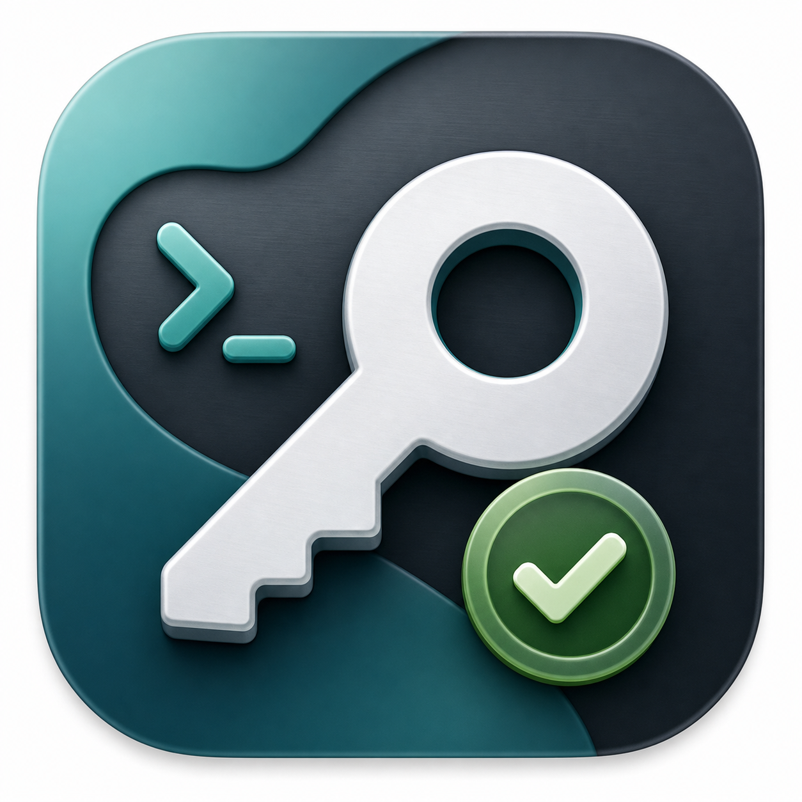
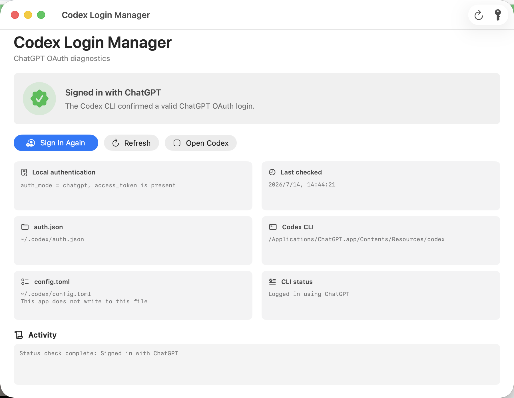

<p align="center">
  
</p>

<h1 align="center">Codex 登录管理 for macOS</h1>

<p align="center">
  看清 Codex CLI 为什么没有正确登录，并一键重新启动官方 ChatGPT OAuth 流程。
</p>

<p align="center">
  <a href="README.md">English</a>
  ·
  <a href="https://github.com/xiaohei210509/CodexLoginManager/releases"><strong>下载 macOS 版本</strong></a>
</p>

<p align="center">
  <a href="https://github.com/xiaohei210509/CodexLoginManager/releases"></a>
  <a href="https://github.com/xiaohei210509/CodexLoginManager/releases"></a>
  <a href="https://github.com/xiaohei210509/CodexLoginManager/actions/workflows/build.yml"></a>
  
  <a href="LICENSE"></a>
</p>



Codex 登录管理会显示 Codex CLI 实际正在使用 ChatGPT OAuth、API key 模式、不完整的 `auth.json`，还是根本没有找到 CLI。它会调用官方 `codex login` 打开浏览器授权，并在结束后自动复查。本工具不自行实现 OAuth、不接收密码，也不会上传登录凭据。

## 为什么不只运行一条 `codex login`？

- 明确区分 ChatGPT OAuth 和 API key 模式。
- 显示实际命中的 `ChatGPT.app`、`Codex.app`、`PATH` 或常见独立安装目录中的 CLI。
- 区分 `~/.codex/auth.json` 缺失、损坏、不完整和过期等状态。
- 启动官方浏览器登录，并在流程结束后自动重新检查。
- 在界面显示前脱敏已知的 API key、OAuth token 和 JWT 格式，降低意外暴露风险。
- 不直接修改 `~/.codex/config.toml`。

## 安装

1. 打开 [Releases 页面](https://github.com/xiaohei210509/CodexLoginManager/releases)。
2. 下载 `CodexLoginManager-*-macOS-universal.zip`，也可以用 `SHA256SUMS.txt` 校验文件。
3. 解压后把 `CodexLoginManager.app` 移到 `/Applications`。
4. 先尝试正常打开一次。如果 macOS 阻止启动，请进入**系统设置 > 隐私与安全性**，为 Codex Login Manager 点击**仍要打开**，然后再次确认**打开**。

下载包同时支持 Apple Silicon 和 Intel Mac。它是开源、ad-hoc 签名的社区 beta，目前还没有经过 Apple 公证，因此 macOS 可能显示“无法验证开发者”。请按 [Apple 的“仍要打开”说明](https://support.apple.com/zh-cn/102445) 操作，不要全局关闭 Gatekeeper。

系统要求为 macOS 14 或更高版本，并且以下任一官方 Codex CLI 可用：

| 安装方式 | CLI 路径 |
| --- | --- |
| 当前 app 内置 CLI | `ChatGPT.app` 或 `Codex.app` 中的 `Contents/Resources/codex-cli/bin/codex` |
| 内置原生程序回退 | `Contents/Resources/codex-cli/CodexCLI.app/Contents/MacOS/codex` |
| 旧版 app 布局 | `Contents/Resources/codex` |
| 独立 CLI | `PATH`、Homebrew、`~/.local/bin`、Volta 或 nvm 安装目录 |

从 v1.0.0-beta.3 起，应用同时检查系统和用户的 Applications 目录，每次刷新都会重新查找 CLI。
从 Finder 启动也无需先加载 shell 配置才能找到 nvm。

## 本地听写补丁管理

从 v1.0.0-beta.4 起，应用已内置自动适配的原生听写补丁引擎和代码解析器，不再需要 Node.js、外部脚本、
手动选择资源目录或另行准备补丁安装包。首次开启时会直接从本机已安装的官方原版
生成经过验证的备份和补丁副本，并在原位置完成替换。页面保留状态检查、开关和中断恢复。

引擎按代码结构识别目标，不依赖每版文件名和固定版本号，并按构建独立保存校验记录和备份。
遇到多义匹配、无法识别的修改或结构大改时拒绝套用，必要时仍需更新补丁规则。
beta.3 及更早的下载包仍使用旧的外部工具界面，请下载 beta.4 或更新版本使用内置引擎。

管理页检测到官方稳定版更新时显示“更新 Codex”按钮，没有更新时隐藏。
确认后下载完整官方 ZIP，验证 Ed25519 和 OpenAI 应用签名，再请求正常退出、更新并重开。
已开启的补丁会自动尝试适配；如果不兼容，保留官方新版并提示，不强行打补丁或强制结束进程。
更新检查固定发送 `plan_type=plus` 和 `beta=false`，不读取账号凭据或检测实际订阅，
也不保证始终与官方客户端的个性化更新提示一致。

开启补丁会改变 Codex 安装并使用本地签名，可能需要重新授予权限或登录，
部分系统集成可能不可用；关闭恢复官方备份。账号和工作区限制不变，
真实转写仍须手动验证。备份和生成的副本保存在
`~/Library/Application Support/CodexLoginManager/DictationPatch`，请预留数 GB 空间。
本项目和应用下载包均不分发原版备份或修改版 Codex，也不包含全局听写功能。
安全边界见[补丁引擎说明](docs/DICTATION_PATCH_PROTOCOL.md)。

## 隐私与安全

- 只在本机读取 `~/.codex/auth.json`，用于判断登录模式。
- 调用已安装的官方 `codex login status` 和 `codex login`。
- CLI 输出显示前会脱敏命名凭据、OpenAI 风格 API key 和 JWT。
- 不写入 `~/.codex/config.toml`。
- 不包含遥测、账号系统、自建服务器或本工具发起的第三方网络请求。

不要在公开 Issue 中上传 `auth.json`、API key、OAuth token、JWT 或未经脱敏的完整日志。完整边界请看[隐私说明](docs/PRIVACY.md)和[安全政策](SECURITY.md)。

## 从源码构建

需要 macOS 14+、Swift 6 和 Xcode 16 或更高版本。

```bash
git clone https://github.com/xiaohei210509/CodexLoginManager.git
cd CodexLoginManager
./script/build_and_run.sh
```

其他常用命令：

```bash
swift test --disable-index-store -j 1
./script/build_and_run.sh --build
./script/build_and_run.sh --verify
./script/package_release.sh 1.0.0-beta.4
```

应用会跟随 macOS 语言设置，目前包含英文和简体中文。GitHub Actions 会运行单元测试、构建应用包、验证签名，并为版本 tag 生成 universal2 Release。

## 帮助与贡献

- [故障排查](docs/TROUBLESHOOTING.md)
- [隐私说明](docs/PRIVACY.md)
- [安全政策](SECURITY.md)
- [贡献指南](CONTRIBUTING.md)
- [更新日志](CHANGELOG.md)

欢迎提交清晰的错误报告和聚焦的 Pull Request。请使用仓库模板，避免意外公开认证数据。

## 许可证与商标声明

本项目使用 [MIT License](LICENSE)。它是独立的社区项目，不是 OpenAI 官方产品，也未获得 OpenAI 的关联或背书。ChatGPT、Codex 和 OpenAI 是其各自权利人的商标。
